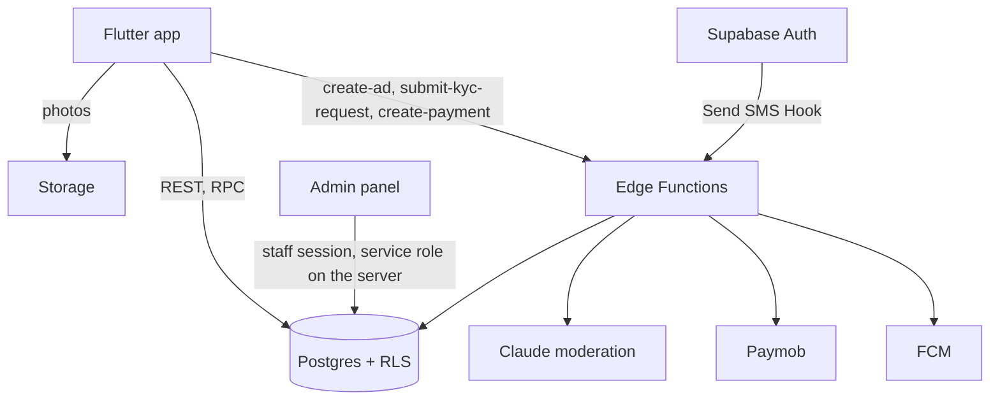

# Wasla (وصلة) — Classifieds for Egypt

Wasla is a classifieds app: people post ads with photos, buyers browse, search and contact sellers by phone or WhatsApp. Ads are reviewed by staff, helped by an automatic first pass with Claude. Sellers can verify their identity and pay to promote ads.

## Architecture

| Part | Stack | Folder |
|---|---|---|
| Mobile app | Flutter 3.41, Riverpod, GoRouter | `frontend/mobile/wasla` |
| Admin panel | Next.js 14 (App Router), staff sign-in with TOTP | `frontend/admin` |
| Backend | Supabase: Postgres with RLS, Auth, Storage, Edge Functions (Deno) | `supabase/` |
| Payments | Paymob (card page hosted by Paymob) | `supabase/functions/create-payment`, `payment-webhook` |
| Push | Firebase Cloud Messaging | `supabase/functions/dispatch-notifications` |
| SMS for OTP | Auth Send SMS Hook | `supabase/functions/send-sms-hook` |
| Crash reporting | Sentry (off unless a DSN is set) | see [Environment](#environment) |



Other folders: `docs/` (SRS, plans, audit report, legal drafts), `data/sources/` (official administrative divisions, CC BY-IGO), `scripts/` (data tools).

## Running locally

### Prerequisites
- Flutter 3.41.9, Node 24, Deno 2.1.4, Docker, and the Supabase CLI 2.120.0 (or `npx -y supabase@2.120.0`). These are the versions CI uses (`.github/workflows/ci.yml`).

### 1. Backend
```bash
cp supabase/.env.example supabase/.env
npx -y supabase@2.120.0 start
```
`supabase/.env` holds the SMS hook secret and a fake Twilio, so nothing is really sent. The test number `+201000000101` signs in with code `123456` (local only, in `supabase/config.toml`). `supabase status` prints the local URL and keys.

Edge Function secrets for `supabase functions serve` go in `supabase/functions/.env` (template: `supabase/functions/.env.example`).

### 2. Mobile app
Settings are passed at build time, not from a `.env` file:
```bash
cd frontend/mobile/wasla
flutter pub get
flutter run --dart-define=SUPABASE_URL=http://10.0.2.2:54321 --dart-define=SUPABASE_ANON_KEY=<anon key from supabase status>
```
The Google Maps key comes from the `MAPS_API_KEY` environment variable or `android/local.properties` (Android) and `ios/Flutter/Maps.xcconfig` (iOS); none is in the repository.

### 3. Admin panel
```bash
cd frontend/admin
npm ci
NEXT_PUBLIC_SUPABASE_URL=http://localhost:54321 NEXT_PUBLIC_SUPABASE_ANON_KEY=<anon key> SUPABASE_SERVICE_ROLE_KEY=<service role key> npm run dev
```
Staff accounts need the `moderator` or `admin` role and a TOTP factor.

## Environment

| Where | Variable | Required |
|---|---|---|
| App (`--dart-define`) | `SUPABASE_URL`, `SUPABASE_ANON_KEY` | yes |
| App (`--dart-define`) | `SENTRY_DSN`, `SENTRY_ENVIRONMENT` | no |
| Admin | `NEXT_PUBLIC_SUPABASE_URL`, `NEXT_PUBLIC_SUPABASE_ANON_KEY`, `SUPABASE_SERVICE_ROLE_KEY` (server only) | yes |
| Admin | `SENTRY_DSN`, `NEXT_PUBLIC_SENTRY_DSN`, `NEXT_PUBLIC_SENTRY_ENVIRONMENT` | no |
| Edge Functions | see `supabase/functions/.env.example` | per function |

Crash reports send no default PII, and phone numbers, emails and tokens are removed before sending.

## Tests

| Suite | Command |
|---|---|
| Database (pgTAP) | `npx -y supabase@2.120.0 test db` |
| Edge Functions | `cd supabase/functions && deno test --no-lock --allow-net=127.0.0.1 --allow-env=SENTRY_DSN,SENTRY_ENVIRONMENT` |
| Local integration (stack running) | the `*.local.ts` files listed in the "Integration tests" step of `.github/workflows/ci.yml`, with `WASLA_SUPABASE_URL`, `WASLA_SUPABASE_ANON_KEY`, `WASLA_SUPABASE_SERVICE_ROLE_KEY` set |
| Admin | `cd frontend/admin && npm test` |
| Flutter | `cd frontend/mobile/wasla && flutter analyze && flutter test` |

`supabase/tests/live/` calls real services (Anthropic, FCM, Paymob sandbox, SMS) and needs real keys; it is not part of CI.

## Deployment
See `docs/wasla_production_migration_plan.md` (database, functions, secrets, Auth hooks, Storage image transformations on the Pro plan, Flutter build settings, Sentry) and `docs/INTEGRATION_CHECKLIST.md` for the third-party accounts to set up.

## Status
The audit and the work since are tracked in `docs/audit/AUDIT_REPORT.md`. Legal texts in `docs/legal/` are drafts and need a lawyer's review before publishing.

## Contributing
See [CONTRIBUTING.md](CONTRIBUTING.md). Security reports: [SECURITY.md](SECURITY.md).

## License
MIT, see [LICENSE](LICENSE). The administrative divisions in `data/sources/` are CC BY-IGO (see `data/sources/README.md`).
