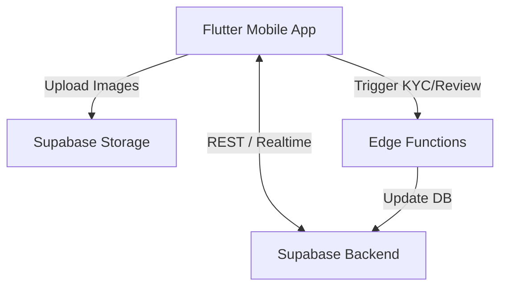

# Wasla (وصلة) — Smart Classifieds Platform

Wasla is a modern, high-performance classifieds platform designed for the MENA region. It connects buyers and sellers seamlessly through an intuitive mobile interface, robust backend, and intelligent content review system.


## Architecture Overview

Wasla is built on a scalable and secure architecture utilizing the following technologies:

- **Frontend:** Flutter (Mobile App), Riverpod (State Management), GoRouter (Routing)
- **Backend/BaaS:** Supabase (PostgreSQL, Authentication, Storage, Edge Functions)
- **Design System:** Custom theme with modern typography and fluid animations.

### High-Level Diagram



## Key Features

- **Dynamic Categories & Fields:** Ad categories support dynamic form fields (e.g., mileage for cars, area for real estate), ensuring structured data collection.
- **Smart Ad Publishing Wizard:** A multi-step, resilient ad publishing flow that handles draft state, image uploads, and geographical tagging effortlessly.
- **Automated Content Review:** Edge functions integrate with AI content moderation to automatically flag or approve ads based on policy rules.
- **KYC Integration:** Built-in identity verification workflow to establish trust between buyers and sellers.
- **Secure Authentication:** Passwordless and traditional authentication flows powered by Supabase Auth.
- **Role-Level Security (RLS):** Strict database policies ensure users can only access and modify their own data.

## Project Structure

```text
wasla/
├── frontend/
│   ├── mobile/         # Main Flutter application
│   └── admin/          # Admin dashboard (Web)
├── backend/            # Backend architecture documentation
├── supabase/           # Supabase Edge Functions and Configuration
├── database/           # SQL migration scripts and seed data
├── scripts/            # Automation, testing, and utility scripts
└── docs/               # In-depth architectural and API documentation
```

## Getting Started

### Prerequisites

- [Flutter SDK](https://flutter.dev/docs/get-started/install) (latest stable)
- [Supabase CLI](https://supabase.com/docs/guides/cli) (optional, for local development)
- Dart SDK

### Installation

1. **Clone the repository:**
   ```bash
   git clone https://github.com/yourusername/wasla.git
   cd wasla/frontend/mobile/wasla
   ```

2. **Install dependencies:**
   ```bash
   flutter pub get
   ```

3. **Environment Setup:**
   Create a `.env` file in the root of the mobile project:
   ```env
   SUPABASE_URL=your_supabase_project_url
   SUPABASE_ANON_KEY=your_supabase_anon_key
   ```

4. **Run the app:**
   ```bash
   flutter run
   ```

## Development & Deployment

To deploy edge functions or manage the database, navigate to the `supabase/` directory and use the Supabase CLI. For comprehensive database seeding and utility scripts, refer to the tools inside the `scripts/` directory.

## Contributing

Please see [CONTRIBUTING.md](CONTRIBUTING.md) for details on our code of conduct, and the process for submitting pull requests.

## License

This project is licensed under the MIT License - see the [LICENSE](LICENSE) file for details.
