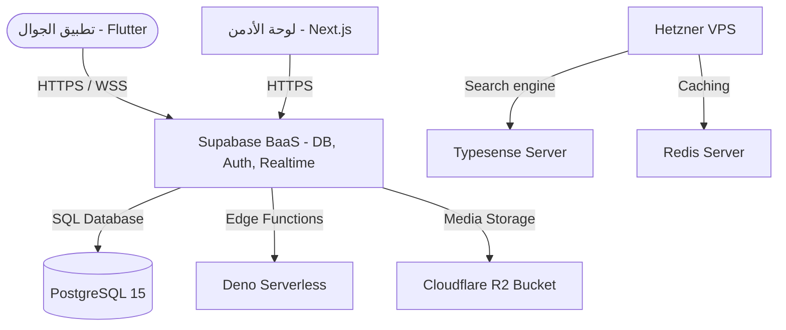

# ⚙️ خطة النشر والعمليات والنسخ الاحتياطي — منصة "وصلة" (Wasla DevOps, Deployment & Backup Plan)

تحدد هذه الوثيقة البنية التحتية البرمجية لمنصة "وصلة" (Wasla)، وكيفية إدارة بيئات العمل، وإعداد خطوط التطوير والنشر المستمر (CI/CD)، والسياسة المتبعة لحماية البيانات من الضياع عبر النسخ الاحتياطي.

---

## 1. هيكل البنية التحتية (Infrastructure Architecture)

يتكون نظام "وصلة" من خمسة مكونات سحابية أساسية موزعة لضمان الأداء والاستقرار والتكلفة الاقتصادية:

1. **Supabase Cloud (BaaS):** كـ Backend أساسي للتحكم بالمصادقة، قواعد البيانات PostgreSQL 15، والـ Realtime WebSockets.
2. **Vercel Cloud:** لاستضافة لوحة تحكم الإدارة والمشرفين (Next.js 14) وضمان سرعة تحميلها عالمياً.
3. **Cloudflare R2:** لتخزين صور الإعلانات والصور الشخصية بصفر رسوم نقل بيانات (Zero Egress Fees).
4. **Hetzner Cloud (VPS - CX11):** سيرفر خاص بقيمة $5 شهرياً لتشغيل محرك البحث العربي السريع (Typesense) والـ Cache والمهام الخلفية (Redis).
5. **متاجر التطبيقات:** Google Play Console للاندرويد، و Apple App Store للـ iOS لتوزيع تطبيق الجوال للمستخدمين.

---

## 2. بيئات العمل (Environments)

لضمان جودة الأكواد وتجنب المشاكل في السيرفر الفعلي، نعتمد على ثلاثة بيئات عمل منفصلة بالكامل:

| البيئة | مكان الاستضافة | الغرض منها | قاعدة البيانات |
| :--- | :--- | :--- | :--- |
| **التطوير (Development)** | أجهزة المطورين محلياً (Docker) | برمجة الميزات وتجربتها محلياً بشكل سريع. | نسخة PostgreSQL محلية عبر Docker. |
| **التجربة (Staging / QA)** | مشروع Supabase مجاني + Vercel Preview | اختبار التطبيق وتكامل الميزات والـ QA والمدفوعات التجريبية. | قاعدة بيانات تجريبية منعزلة مطابقة للإنتاج. |
| **الإنتاج (Production)** | مشروع Supabase مدفوع ($25) + Vercel Live | البيئة الحقيقية التي يدخل إليها المستخدمون الفعليون. | قاعدة بيانات الإنتاج الرسمية المؤمنة بالكامل بالـ RLS. |

---

## 3. خط التطوير والنشر المستمر (CI/CD Pipeline)

تتم أتمتة عملية البناء والنشر باستخدام **GitHub Actions** لمنع أي أخطاء بشرية أثناء الرفع:

### أ. مسار تطبيق الجوال (Flutter CI/CD):
1. عند دمج كود جديد في فرع `main`:
   * يتم تشغيل الفاحص البرمجي (`flutter analyze`).
   * تشغيل كافة اختبارات الوحدات والواجهات المكتوبة (`flutter test`).
   * بناء نسخة الأندرويد (`Android App Bundle - AAB`) ونسخة الـ iOS.
   * الرفع التلقائي إلى متجر جوجل للتجربة الداخلية (Google Play Internal Testing) ومتجر أبل (TestFlight).

### ب. مسار الـ Backend وقاعدة البيانات (Supabase CI/CD):
1. تتم إدارة قاعدة البيانات بنظام **Migrations** (الهجرة البرمجية للبيانات):
   * يُمنع تعديل الجداول يدوياً في الإنتاج.
   * يتم إنشاء ملف SQL للتغيير محلياً.
   * عند دمج التغيير، يقوم GitHub Actions بمطابقة وفحص الـ Migrations ثم دفعها لسيرفر الإنتاج لتحديث الجداول تلقائياً باستخدام Supabase CLI.

---

## 4. سياسة النسخ الاحتياطي واستعادة البيانات (Backup & Recovery)

لحماية بيانات المستخدمين والإعلانات من الكوارث التقنية:

### أ. قاعدة البيانات (Database Backups):
* **نسخ احتياطي يومي تلقائي:** يتم أخذ لقطة كاملة (Snapshot) لقاعدة البيانات يومياً عند الساعة 3:00 صباحاً بتوقيت مصر والاحتفاظ بها لمدة 30 يوماً (مضمنة في باقة Supabase Pro).
* **نسخ احتياطي خارجي أسبوعي:** يتم تشغيل Script مجدول كل يوم جمعة لأخذ نسخة كاملة من الجداول (`pg_dump`) وتخزينها مشفرة في حساب Cloudflare R2 منفصل لمزيد من الأمان.

### ب. الملفات والصور (Storage Backups):
* بما أن الصور تُخزن في Cloudflare R2، نعتمد على ميزة **Object Versioning** للرجوع لأي صورة تم حذفها بالخطأ، وميزة **Multi-Region Replication** لتوزيع الملفات في أكثر من سيرفر جغرافي لضمان عدم ضياعها.

### ج. خطة الطوارئ للاسترجاع (Disaster Recovery Plan):
في حال حدوث خلل كامل في السيرفر الرئيسي:
1. يتم تهيئة سيرفر Supabase جديد.
2. تشغيل أحدث ملف SQL Migrations لبناء هيكل الجداول الفارغة.
3. استعادة البيانات من آخر نسخة احتياطية يومية (`pg_restore`).
4. إعادة توجيه الـ DNS الخاص بالـ API وسيعود النظام للعمل خلال أقل من ساعتين بحد أقصى لفقد البيانات لا يتجاوز 24 ساعة (RPO < 24 Hours).

---

## 5. مراقبة النظام والأداء (Monitoring & Analytics)

نستخدم الأدوات التالية لمراقبة صحة المنصة واستباق المشاكل:
* **Sentry:** لالتقاط أي انهيار (Crash) يحدث في هواتف المستخدمين أو لوحة التحكم وإرسال تنبيه فوري للمطورين مع تفاصيل الخطأ.
* **Uptime Robot:** لفحص عمل السيرفر والـ API كل 5 دقائق وتنبيه الفريق في حال توقف الخدمة.
* **PostHog:** لمراقبة أداء واستخدام ميزات التطبيق ومعرفة الشاشات التي يقضي فيها المستخدمون معظم وقتهم.
