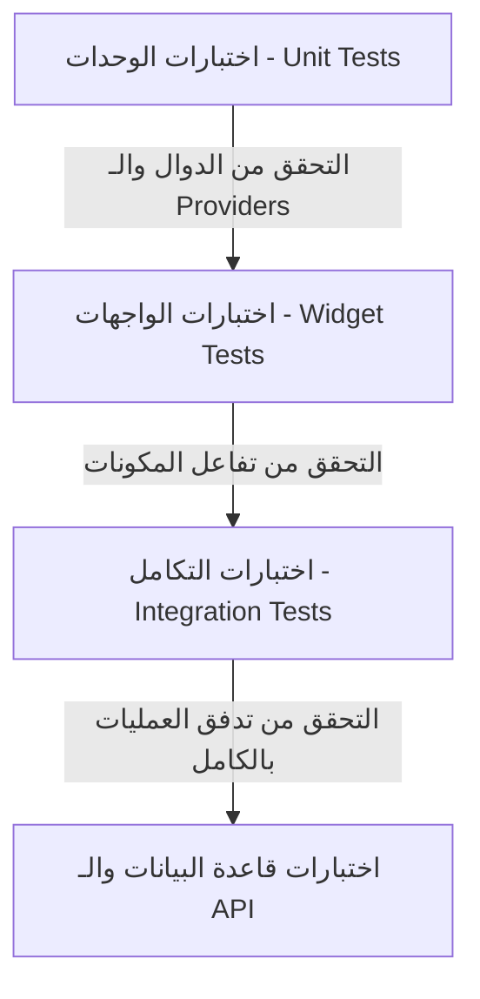

# 🧪 خطة الجودة والاختبارات — منصة "وصلة" (Wasla QA & Testing Plan)

تحدد هذه الخطة الاستراتيجية المتبعة لاختبار تطبيق "وصلة" (Wasla) والتأكد من خلوه من الأخطاء البرمجية قبل إطلاقه للمستخدمين في السوق المصري، لضمان استقرار الواجهات وسلاسة الأداء وأمان المدفوعات والتوثيق.

---

## 1. أهداف واجهات الاختبار ومستويات الجودة (Quality Goals)

نهدف من خلال هذه الخطة إلى تحقيق معايير الجودة التالية:
1. **استقرار شاشات الدخول والنشر:** منع حدوث أي تجمد (Freeze) أو انهيار (Crash) أثناء تعبئة النماذج أو رفع الصور.
2. **تغطية برمجية ممتازة:** تغطية اختبارات الوحدات (Unit Tests) بنسبة لا تقل عن **70%** من المنطق البرمجي (Business Logic).
3. **أمان وثائق المستخدمين:** التأكد التام من فشل أي محاولات غير مصرحة للوصول إلى مستندات الهوية (Private Buckets).
4. **التوافق التام مع اللغة العربية (RTL):** التحقق من سلامة محاذاة النصوص والخطوط واتجاه الأزرار.

---

## 2. مستويات وأنواع الاختبارات (Testing Levels)

ينقسم الهيكل الاختباري لمشروع "وصلة" إلى أربعة مستويات أساسية:

### أ. اختبارات الوحدات (Unit Testing):
* **المستهدف:**
  * الـ Providers الخاصين بـ Riverpod (مثل `authStateProvider`, `adsProvider`).
  * دوال معالجة وتحويل البيانات (JSON Serialization لـ Models).
  * دوال التحقق المساعدة (مثل مطابقة رقم الهاتف المصري وصيغته الصحيحة `+201xxxxxxxxx`).
* **الأدوات المستخدمة:** حزمة `flutter_test` الرسمية، ومكتبة المحاكاة `mocktail` أو `mockito`.
* **مثال اختبار:** التحقق من أن دالة فحص الهاتف تعطي خطأ عند إدخال رقم ناقص أو يحتوي على أحرف.

### ب. اختبارات الواجهات والمكونات (Widget Testing):
* **المستهدف:**
  * كروت الإعلانات المخصصة (`AdCard` و `FeaturedAdCard`) وتأكيد ظهور الشارات بالشكل الصحيح.
  * زر الشعار المخصص للاتصال والواتساب وظهورهم في شاشة تفاصيل الإعلان.
  * ظهور رسائل الخطأ الحمراء عند إدخال حقول فارغة في نموذج النشر (`AdFormScreen`).
* **الأدوات المستخدمة:** `WidgetTester` المضمن في Flutter SDK.

### ج. اختبارات التكامل وسيناريوهات المستخدم (Integration Testing):
* **المستهدف:** اختبار تدفقات العمليات الكاملة (User Journeys) داخل بيئة محاكاة حقيقية:
  * **سيناريو الدخول:** إدخال الهاتف -> محاكاة إرسال OTP -> إدخال الرمز -> تسجيل الدخول والوصول للرئيسية.
  * **سيناريو النشر:** اختيار الفئة -> تعبئة الفورم -> رفع الصور -> معاينة -> تأكيد النجاح.
* **الأدوات المستخدمة:** مكتبة `integration_test` الرسمية في Flutter.

### د. اختبارات قاعدة البيانات وصلاحيات الـ API (Database API Testing):
* **المستهدف:**
  * اختبار أمان قواعد الـ RLS (تأكيد أن المستخدم "أ" يفشل برمجياً في قراءة إشعارات أو معاملات المستخدم "ب").
  * اختبار Triggers قاعدة البيانات (مثل تحديث معدل تقييم المستخدم تلقائياً عند إضافة مراجعة جديدة له).
* **الأدوات المستخدمة:** Postman / Bruno لاختبار الـ Endpoints، واختبارات SQL باستخدام أداة `pgTAP`.

---

## 3. اختبارات خاصة ببيئة السوق المصري (Egyptian Context QA)

نظراً للخصائص المميزة للشبكات والأجهزة في مصر، سنقوم بإجراء اختبارات إضافية مخصصة:

| نوع الاختبار المخصص | الهدف منه | آلية الاختبار |
| :--- | :--- | :--- |
| **محاكاة الشبكات الضعيفة (Network Throttling)** | التحقق من سلوك التطبيق تحت شبكة 2G/3G بطيئة. | استخدام أدوات مطوري أندرويد (Emulator Network Speed) للتأكد من ظهور الـ Shimmer/Skeleton loading دون تعطل التطبيق أو حدوث Timeouts غير معالجة. |
| **التوافق البصري للعربية (RTL Validation)** | التحقق من عدم تداخل نصوص خط **Cairo** وضمان اتجاهات الواجهات. | تشغيل التطبيق بلغة النظام العربية، والتأكد من انزلاق القوائم والـ Bottom sheets من اليمين لليسار، وحواف الأزرار ونقاط الاتصال. |
| **اختبار شاشات الهواتف الضعيفة** | التأكد من أن التصميم متجاوب ولا يعطي أخطاء تجاوز الشاشة (RenderFlex overflow). | تجربة واجهات التطبيق على قياس شاشة صغير (360px عرض) للتأكد من مرونة البطاقات والنماذج واستخدام قوائم قابلة للتمرير (Scrollable views). |

---

## 4. تصنيف الأخطاء وإدارة إصلاحها (Defect Severity)

تُصنف الأخطاء المكتشفة أثناء الاختبارات إلى ثلاث مستويات:

1. **حرجة (Critical / Blocker):** تتسبب في انهيار التطبيق، أو فشل تسجيل الدخول، أو توقف عملية الدفع بالكامل، أو خرق أمني يسرب بيانات الهوية. *يمنع هذا الخطأ نشر التطبيق تماماً*.
2. **كبيرة (Major):** ميزة أساسية لا تعمل بالشكل المتوقع ولكن التطبيق يظل مستقراً (مثل: عدم عمل زر الحفظ في المفضلة مؤقتاً، أو تأخر ظهور الصورة الشخصية). *يجب إصلاحه قبل الإطلاق التجاري*.
3. **طفيفة (Minor / Cosmetic):** خطأ في حجم الخط، أو تباعد الحواف، أو حركة انتقالية غير سلسة. *يمكن تأجيله لتحديثات ما بعد الإطلاق*.

---

## 5. شروط الموافقة على نشر الإصدار (Quality Gates)

لكي نعلن أن نسخة التطبيق جاهزة للنشر والاستخدام الفعلي (Production Ready):
* [ ] صفر أخطاء من المستوى الحرج (Critical).
* [ ] تغطية اختبارات الوحدات (Unit Test Coverage) تزيد عن 70%.
* [ ] نجاح اختبارات الأمان لقواعد الـ RLS وحظر المستندات الشخصية.
* [ ] نجاح عمليات الدفع التجريبية لـ Paymob بالبطاقة وفوري والمحفظة.
