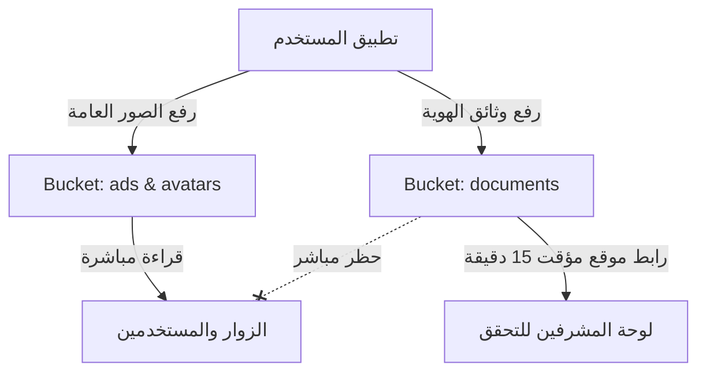
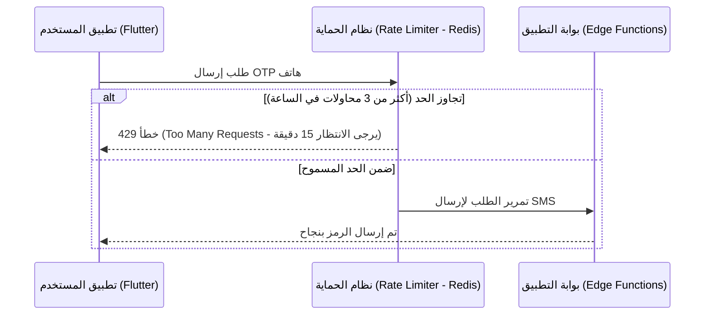

# 🛡️ خطة الأمن وحماية البيانات والخصوصية — منصة "وصلة" (Wasla Security & Privacy Plan)

بما أن منصة "وصلة" تتعامل مع بيانات حساسة للغاية خاصة بالمواطنين المصريين (مثل بطاقات الرقم القومي، صور السيلفي للمطابقة، أرقام الهواتف، والمدفوعات الإلكترونية)، فإن هذا المستند يمثل خطة العمل الأمنية لحماية هذه البيانات وتأمين النظام ضد الاختراقات أو تسريب البيانات.

---

## 1. تصنيف البيانات (Data Classification)

قمنا بتصنيف البيانات داخل قاعدة بيانات وملفات "وصلة" إلى ثلاثة مستويات لتطبيق السياسات الأمنية المناسبة:

| مستوى الحساسية | نوع البيانات | سياسة التخزين والوصول |
| :--- | :--- | :--- |
| **علني (Public)** | تفاصيل الإعلانات، الأسعار، أسماء المعلنين العامة، الصور العامة للإعلانات. | يُتاح للجميع (الزوار والمسجلين)، يُخزن في Buckets علنية ويوزع عبر CDN. |
| **حساس (Private / Sensitive)** | البريد الإلكتروني، رقم الهاتف، الموقع الجغرافي الدقيق للمعلن، عناوين IP للجلسات. | لا يظهر إلا للمستخدم نفسه أو للمشترين بعد ضغط زر "تواصل". يُحمى بواسطة قواعد RLS. |
| **حساس جداً (Confidential)** | صور بطاقة الرقم القومي (وجه وظهر)، صور السيلفي الشخصية، أرقام الهواتف القومية، رموز الـ OTP، توقيعات بوابة الدفع (Paymob Webhook Secrets)، كلمات المرور الـ Hash. | يُخزن مشفراً في قاعدة البيانات. المستندات تُخزن في Bucket خاص مغلق بالكامل (Private Bucket) ولا يتم توليد روابط تصفح لها إلا للمشرفين بصلاحية مؤقتة (15 دقيقة فقط). |

---

## 2. سياسة أمان الملفات وتخزين المستندات (Storage Security Policy)

تُقسم الملفات المرفوعة عبر تطبيق الـ Flutter إلى ثلاثة مستودعات (Storage Buckets) في Supabase Storage أو Cloudflare R2:



### أ. المستودعات العامة (`ads` & `avatars`):
* **الصلاحية:** قراءة علنية (Public Read) للجميع.
* **الكتابة والتعديل:** مسموح فقط للمستخدمين المصادقين (Authenticated Users) بشرط أن يكونوا هم أصحاب الإعلان أو الحساب (يتم التحقق عبر سياسات Storage Policies).
* **الحماية:** يتم فحص أحجام الصور (الحد الأقصى 5 ميجابايت للإعلانات، و2 ميجابايت للرمز الشخصي) مع فلترة الامتدادات المقبولة فقط (`.jpg`, `.jpeg`, `.png`, `.webp`).

### ب. المستودع المغلق (`documents`):
* **الصلاحية:** مغلق تماماً (Private). لا يمكن لأي رابط خارجي الوصول للصور مباشرة.
* **الوصول:** فقط لـ Supabase Edge Functions أو المشرفين الموثقين.
* **آلية المعاينة للمشرف:** عند فتح المشرف لطلب توثيق حساب، يقوم السيرفر بتوليد رابط وصول مؤقت مشفر (Signed URL) صالح لمدة **15 دقيقة فقط**، وينتهي تلقائياً لمنع تسريب الروابط.
* **سياسة إتلاف البيانات (Data Destruction Policy):**
  * صور البطاقة تُحذف من Storage تلقائياً بعد **7 أيام من القبول**، وبعد **30 يوماً من الرفض** (مهلة التظلم).
  * الحذف يتم عن طريق Edge Function `purge-kyc-documents`، وتُشغَّل يومياً بـ cron.
  * يبقى سجل القرار نفسه: الحالة، وتاريخ القرار، وتاريخ الحذف. وتبقى حالة الحساب `is_id_verified`.

---

## 3. أمان قاعدة البيانات وصلاحيات الوصول (Database RLS Policies)

نظراً لاعتمادنا على Supabase PostgreSQL، سيتم تفعيل ميزة **Row Level Security (RLS)** على جميع الجداول بلا استثناء لضمان ألا يتمكن أي مستخدم من قراءة أو تعديل بيانات مستخدم آخر من خلال الـ API مباشرة.

### نماذج لسياسات الأمان الفنية (SQL RLS Rules):

#### أ. جدول الحسابات الشخصية (`users`):
* **القراءة:** مسموح للجميع قراءة الأعمدة العامة فقط (الاسم، الصورة الشخصية، التقييم، شارة التوثيق).
* **التعديل:** مسموح فقط للمستخدم الذي يطابق معرّفه الجلسة الحالية:
  ```sql
  CREATE POLICY "Users can update their own profile" 
  ON public.users 
  FOR UPDATE 
  USING (auth.uid() = id);
  ```

#### ب. جدول المعاملات المالية (`transactions`):
* **القراءة:** مسموح فقط للمستخدم صاحب المعاملة، أو المشرف المالي (Admin):
  ```sql
  CREATE POLICY "Users can view their own transactions" 
  ON public.transactions 
  FOR SELECT 
  USING (auth.uid() = user_id OR auth.jwt() ->> 'user_type' = 'admin');
  ```

#### ج. سجل العمليات والرقابة (`audit_logs`):
* **الصلاحية:** مغلق تماماً للقراءة والكتابة أمام جميع مستخدمي التطبيق. الكتابة تتم تلقائياً من خلال الـ System Triggers في قاعدة البيانات عند قيام المشرفين بأي إجراء إداري.

---

## 4. أمان معالجة الرقم القومي والتحقق الذاتي (KYC Flow Security)

لمنع عمليات التزييف وضمان موثوقية الهوية في "وصلة":

1. **منع الرفع من الاستوديو (Direct Camera Capture Only):**
   في تطبيق Flutter، يتم إجبار المستخدم على استخدام الكاميرا الحية لالتقاط صورة بطاقة الرقم القومي وصورة السيلفي، مع تعطيل خيار اختيار صورة من الاستوديو لمنع استخدام برامج التعديل (Photoshop).
2. **مطابقة الصورة الشخصية بالذكاء الاصطناعي:**
   يتم إرسال صورة السيلفي وصورة البطاقة إلى Edge Function تقوم بمطابقة الملامح والتأكد من مطابقة الوجهين لمنع انتحال الشخصية قبل إرسال الطلب للمشرف البشري لتأكيد الطلب.
3. **تشفير الأرقام القومية:**
   يتم تشفير الرقم القومي للمستخدم في قاعدة البيانات باستخدام نظام التشفير `pgcrypto` بـ AES-256، بحيث لا يظهر كرقم واضح في الجداول حتى لو تم اختراق قاعدة البيانات.

---

## 5. أمان الـ APIs وحماية النظام من الاختراق (API Security & Rate Limiting)

لحماية النظام من هجمات إغراق السيرفر بالطلبات (DDoS) أو استهلاك باقات الرسائل النصية (OTP SMS Spam):



### أ. محدد الطلبات (Rate Limiting Rules):
* **إرسال OTP الهاتف:** يُسمح بـ 3 طلبات كحد أقصى لكل رقم هاتف/عنوان IP في الساعة.
* **البحث والتصفح:** يُسمح بـ 60 طلب في الدقيقة لكل مستخدم.
* **إنشاء الإعلانات:** يُسمح بـ 5 إعلانات كحد أقصى في الساعة للحسابات العادية لمنع إغراق السوق بالإعلانات العشوائية (Spamming).

### ب. التحقق من توقيعات بوابات الدفع (Webhook Verification):
* عند استقبال إشعار الدفع من Paymob، تقوم الـ Edge Function بحساب الـ Hash الرياضي للتوقيع الرقمي (HMAC Signature) باستخدام سر الدفع المخفي (`Paymob_HMAC_Secret`) للتأكد من أن الطلب قادم فعلياً من Paymob وليس طلباً وهمياً من مخترق يحاول تفعيل باقة مجاناً.

---

## 6. الامتثال لقانون حماية البيانات الشخصية المصري (Egyptian GDPR Compliance)

يتوافق هذا التصميم مع قانون حماية البيانات الشخصية المصري رقم 151 لسنة 2020:

1. **حق حذف البيانات (Right to be Forgotten):** 
   يستطيع المستخدم طلب حذف حسابه من شاشة الإعدادات. يقوم النظام فوراً بـ Soft Delete وحجب الحساب، ثم بعد مرور 30 يوماً (فترة تسوية النزاعات المالية إن وجدت)، يتم مسح كافة بياناته الحساسة من السيرفر نهائياً (Hard Delete).

   **التنفيذ** (`request_account_deletion()` و Edge Function `purge-deleted-accounts`):
   * **فور الطلب:** يُخفى الملف الشخصي وكل الإعلانات، ويُمنع تسجيل الدخول، وتنتهي الجلسات، وتُحذف توكنات الإشعارات، ويتوقف البحث المحفوظ.
   * **بعد 30 يوماً:** تُحذف ملفات المستخدم من `ads` و`avatars` و`id-documents`، ثم حساب Auth، ومعه كل البيانات المرتبطة به.
   * **سجلات التدقيق والإشراف** تبقى، مع حذف هوية المنفّذ (`actor_id` / `moderator_id` = NULL).

   **قرار الاحتفاظ بالسجلات المالية:** معاملات الدفع (`transactions`) **لا تُحذف** مع الحساب، بل تُجهَّل هويتها:
   * **ما يبقى:** المبلغ، العملة، النوع، الباقة، الحالة، طريقة الدفع، تاريخ الإنشاء والإتمام، رقم طلب Paymob ورقم معاملة Paymob.
   * **ما يُمسح:** `user_id` ومرجع الإعلان (`reference_id`). ومن الـ metadata يُحذف كل ما ليس في القائمة المسموحة: الاسم، الهاتف، البريد، billing data، أرقام البطاقة، مفاتيح الدفع، وأي metadata أرسلها العميل.
   * **التنفيذ:** trigger `trg_anonymize_user_transactions` والدالة `scrub_transaction_metadata`.
   * **الاختبارات:** `12_transaction_retention.test.sql`، و`purge-deleted-accounts/integration.local.ts` عبر Auth API الحقيقي.
   * **مدة الاحتفاظ المقترحة: 5 سنوات** من تاريخ المعاملة. هذه مدة الاحتفاظ بالدفاتر والسجلات في قانون الإجراءات الضريبية الموحد رقم 206 لسنة 2020، **ويجب تأكيدها من المستشار القانوني**. بعدها تُحذف السجلات المجهولة.
   * **تنبيه:** المحو الآلي بعد المدة غير منفّذ بعد، وهو بند مفتوح.
2. **الحصول على الموافقة الصريحة (Explicit Consent):**
   عند تسجيل الحساب والبدء بالتوثيق الأمني، تظهر رسالة واضحة للمستخدم: *"بالموافقة على التوثيق، أنت تسمح لوصلة بمراجعة هويتك لأغراض الأمان فقط ولن يتم مشاركة بياناتك مع أي طرف ثالث"*.
3. **تقليل البيانات (Data Minimization):**
   لا نطلب أي بيانات لا يحتاجها التطبيق ليعمل (مثلاً لا نطلب تحديد موقع المستخدم الدقيق بالـ GPS بشكل إجباري دائم، بل نكتفي بالمدينة/الحي الذي يحدده يدوياً).
