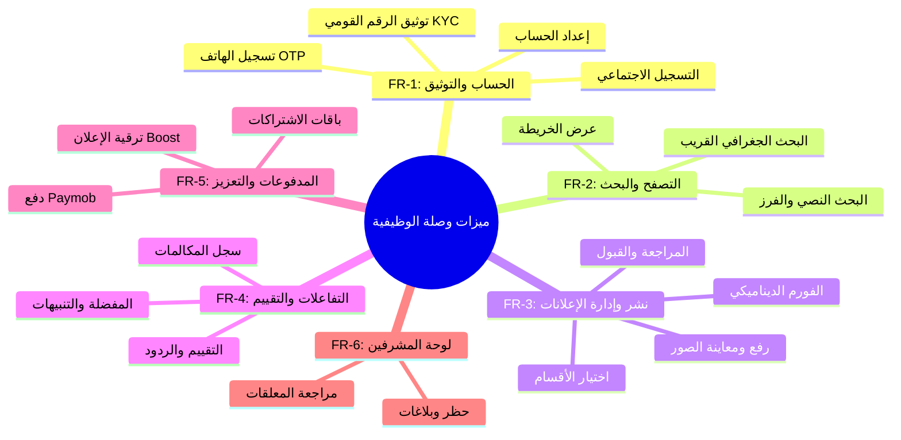

# 📝 مواصفات النظام والمتطلبات البرمجية — منصة "وصلة" (Wasla Software Requirements Specification - SRS)

تمثل هذه الوثيقة المرجع الشامل لكافة متطلبات نظام "وصلة" (Wasla)، وتغطي الأهداف العامة، المتطلبات الوظيفية المفصلة، والمتطلبات غير الوظيفية المحددة لبناء وتشغيل المنصة.

---

## 1. نظرة عامة على النظام (System Overview)

منصة **"وصلة"** هي منصة إعلانات مبوّبة ذكية مخصصة للسوق المصري. ترتكز المنصة على حل ثلاث مشاكل رئيسية في السوق المحلي:
1. **أزمة الثقة:** انتشار الإعلانات الوهمية والنصب، ونعالجها من خلال نظام التوثيق بالرقم القومي (KYC).
2. **صعوبة التواصل:** ونعالجها بتوفير أزرار تواصل مباشر وسجل مكالمات وتكامل مع واتساب والاتصال الهاتفي.
3. **العثور الجغرافي القريب:** ونعالجها باستخدام الفرز الجغرافي الدقيق وتحديد الإعلانات القريبة من موقع المستخدم الفعلي.

---

## 2. المتطلبات الوظيفية (Functional Requirements)

تم تنظيم المتطلبات الوظيفية وتصنيفها برمز (**FR**) لتسهيل تتبعها أثناء البرمجة والاختبار:

### [FR-1] نظام الحسابات والمصادقة والتوثيق (Auth & KYC):
* **FR-1.1:** يجب أن يتمكن المستخدم من تسجيل الدخول أو إنشاء حساب باستخدام رقم الهاتف المصري ويرسل له كود OTP مكون من 6 أرقام للتحقق.
* **FR-1.2:** يجب توفير خيار التسجيل الاجتماعي السريع (Google و Facebook) كبديل للمستخدمين.
* **FR-1.3:** يجب أن يحدد المستخدم مدينته الافتراضية واسمه وصورته الشخصية في خطوة إعداد الملف الشخصي.
* **FR-1.4 (التحقق الأمني):** يجب توفير نظام توثيق اختياري للمستخدم بالرقم القومي (KYC) من خلال رفع صورة البطاقة الشخصية (وجه وظهر) والتقاط سيلفي مباشر لمطابقة الملامح. بعد الموافقة، تمنح له شارة "✓ موثّق".

### [FR-2] البحث والاكتشاف (Search & Discovery):
* **FR-2.1:** يجب أن يقدم التطبيق صفحة رئيسية (Feed) تعرض إعلانات قريبة جغرافياً من المستخدم بناءً على موقعه الفعلي (GPS).
* **FR-2.2:** يجب توفير محرك بحث نصي يفهم مرادفات البحث باللغة العربية ويتغاضى عن الأخطاء الإملائية الشائعة.
* **FR-2.3:** يجب تمكين تصفية وتصفية الإعلانات (Filters) حسب: القسم، نطاق السعر، المدينة، الحي، نوع الإعلان (مطلوب/معروض)، وتاريخ النشر.
* **FR-2.4:** يجب توفير ميزة "عرض الخريطة" لتجميع الإعلانات (Clusters) في مناطق جغرافية محددة.

### [FR-3] نشر وإدارة الإعلانات (Listing Management):
* **FR-3.1:** يجب توفير معالج للنشر (Wizard) من 5 خطوات: (1) اختيار القسم، (2) كتابة التفاصيل الأساسية، (3) رفع حتى 8 صور، (4) تحديد الموقع والسعر، (5) المعاينة النهائية والتأكيد.
* **FR-3.2 (الحقول الديناميكية):** يجب أن يتغير فورم نشر الإعلان ديناميكياً بناءً على القسم المحدد (مثلاً: إعلان السيارات يطلب "سنة الصنع، الكيلومترات"، بينما العقارات تطلب "المساحة، عدد الغرف").
* **FR-3.3 (دورة حياة الإعلان):** بعد النشر، يظل الإعلان معلقاً بانتظار مراجعة المشرف، وبمجرد قبوله ينشر ويبقى نشطاً لمدة 30 يوماً ما لم يقم المستخدم بتعطيله أو تمديده.

### [FR-4] التفاعلات والمراجعات (Interactions & Reviews):
* **FR-4.1:** يجب تمكين المستخدم من حفظ الإعلانات في المفضلة وكتابة ملاحظات شخصية عليها.
* **FR-4.2 (البحث المحفوظ - Watchlist):** يمكن للمستخدم حفظ بحث معين واستقبال إشعارات فورية عند نشر أي إعلان جديد يطابق شروط بحثه.
* **FR-4.3 (سجل المكالمات):** يجب تسجيل كل نقرة على زر الاتصال الهاتفي أو الواتساب في جدول `contact_logs` للتحليلات وإبلاغ المعلن بمصادر اهتمام المشترين.
* **FR-4.4 (التقييمات):** يمكن للمشترين تقييم المعلنين (1-5 نجوم وتعليق) بعد إجراء تواصل معهم، ويحق للمعلن الرد على هذا التقييم لمرة واحدة.

### [FR-5] المدفوعات والـ Boost (Payments & Promotion):
* **FR-5.1:** يجب دمج بوابة Paymob للتعامل مع المدفوعات الإلكترونية بالجنيه المصري (بطاقات البنك، فوري، محفظة المحمول).
* **FR-5.2 (تعزيز الإعلان):** يمكن للمعلن الدفع مقابل ترقية إعلانه إلى (مميز Featured يظهر في الأعلى ببطاقة ذهبية، أو عاجل Urgent، أو Bump لرفعه لأعلى الترتيب).
* **FR-5.3 (الاشتراكات التجارية):** يتيح التطبيق لأصحاب الأعمال (مثل مكاتب العقارات) الاشتراك في باقات شهرية توفر حدود إعلانات أكبر وأدوات تحليل متقدمة.

### [FR-6] لوحة المشرفين والإدارة (Admin & Moderation):
* **FR-6.1:** يجب توفير واجهة للمشرفين لمراجعة الإعلانات المعلقة وقبولها أو رفضها مع تحديد سبب الرفض وإرسال إشعار للمعلن.
* **FR-6.2:** يجب تمكين المشرفين من مراجعة البلاغات المرفوعة ضد الإعلانات أو المستخدمين المشبوهين واتخاذ قرارات الحظر (Banning).

---

## 3. المتطلبات غير الوظيفية (Non-Functional Requirements)

تم تنظيم المتطلبات غير الوظيفية برمز (**NFR**):

### [NFR-1] الأداء والسرعة (Performance):
* **NFR-1.1:** يجب ألا يتجاوز وقت تحميل الصفحة الرئيسية للنتائج 2 ثانية في ظل سرعة إنترنت متوسطة.
* **NFR-1.2:** يجب ضغط كافة الصور المرفوعة تلقائياً على السيرفر وتحويلها لصيغة WebP لتقليل استهلاك باقات الإنترنت للمستخدمين بنسبة 60%+.

### [NFR-2] الأمان والخصوصية (Security & Privacy):
* **NFR-2.1:** يجب تشفير كافة اتصالات الشبكة باستخدام بروتوكول HTTPS/TLS.
* **NFR-2.2:** يجب إخفاء صور مستندات الهوية (رقم قومي) بالكامل في Storage Bucket خاص مشفر، ومنع الوصول إليها إلا بمفاتيح وصول مؤقتة للمشرف الموكل بالتحقق.

### [NFR-3] التوافرية والاعتمادية (Availability & Reliability):
* **NFR-3.1:** يجب أن يظل النظام متاحاً للعمل بنسبة 99.9% من الوقت سنوياً.
* **NFR-3.2:** في حال فشل الاتصال بقاعدة البيانات، يجب أن يحتفظ التطبيق بالإعلانات المحفوظة محلياً (Offline Cache) ليعرضها للمستخدم.

### [NFR-4] متطلبات التوافق والمحاذاة (Compatibility & Localization):
* **NFR-4.1:** يجب دعم اللغة العربية بشكل كامل (محاذاة كاملة RTL) واستخدام خط Cairo المصمم خصيصاً للشاشات الرقمية.
* **NFR-4.2:** يجب أن يعمل تطبيق الجوال بشكل متوافق وسلس على جميع أجهزة أندرويد (إصدار 8 فما فوق) ونظام iOS (إصدار 13 فما فوق).
